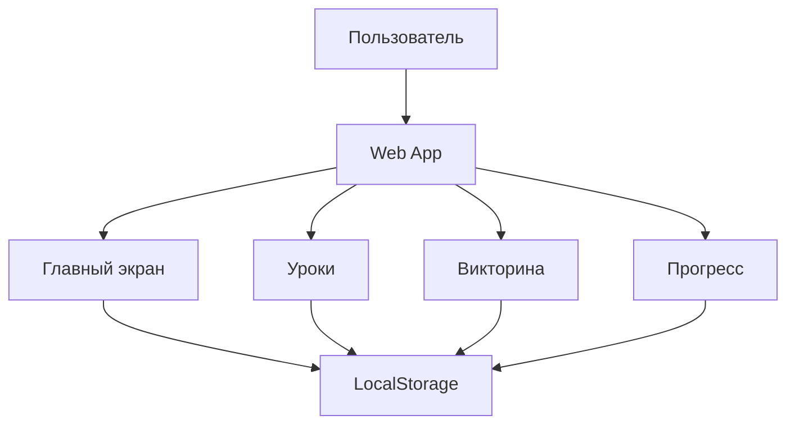

### 🚀 Проект: Foodlingo — питание в формате игры

У вас 1 час до завершения хакатона, поэтому наша задача — не разработать полноценное приложение, а создать яркий, работающий прототип, который демонстрирует идею, вызывает интерес и позволяет жюри сразу понять ценность продукта.

Я бы не стал делать сложный backend, регистрацию, базу данных или полноценную систему рекомендаций. Сейчас это потеря времени.

### 1\. Концепция

Foodlingo — игровое приложение в стиле Duolingo, которое помогает подросткам формировать здоровые пищевые привычки через короткие уроки, задания, очки, серии занятий и игровые достижения.

### 🥦 Foodlingo

Учись питаться лучше — играя!

Вместо скучных лекций о питании:

* короткие уроки на 1–2 минуты;

* игровые задания;

* XP и уровни;

* серия ежедневных занятий 🔥;

* виртуальный прогресс;

* дружелюбный персонаж.

### Главная идея

Не говорить подростку:

> «Фастфуд — это плохо. Перестань его есть».

Вместо этого:

> «Давай научимся делать более осознанный выбор и понимать, что помогает тебе чувствовать себя лучше».

Это важно: приложение не должно демонизировать еду, вызывать чувство вины или предлагать жёсткие диеты.

### 2\. Что именно делаем за час

### MVP — минимальная версия

Всего 4 основных экрана, между которыми можно переключаться.


1\. Главный экран

Прогресс, серия занятий, уровень, кнопка «Продолжить».


2\. Урок

Короткая информация и интерактивное задание.


3\. Викторина

Выбор ответа, мгновенная обратная связь, XP.


4\. Прогресс

Уровень, очки, достижения, изученные темы.

### 3\. Игровая механика

### Прогресс пользователя

| Механика           | Как работает                           |
| ------------------ | -------------------------------------- |
| ⭐ XP               | +10 XP за правильный ответ             |
| 🔥 Streak          | Серия ежедневных занятий               |
| 🏆 Уровни          | Уровень повышается при накоплении XP   |
| ❤️ Жизни           | 3 попытки в уроке                      |
| 🥇 Достижения      | За прохождение уроков                  |
| 🗺️ Карта обучения | Последовательность тематических уроков |

### Темы уроков

* 🥤 Сахар и напитки — сколько сахара в популярных напитках?

* 🍔 Фастфуд — как питаться осознанно, не запрещая себе любимую еду?

* 🥗 Собираем тарелку — как сделать разнообразный приём пищи?

* 🧠 Голод и привычки — почему мы едим, когда скучно?

* 💧 Вода — почему важно пить?

* 🏪 Выбор в магазине — как выбирать продукты?

### 4\. Главный экран

Пример структуры:

```text
┌─────────────────────────────────────┐
│ 🥦 FOODLINGO          🔥 5 дней    │
│                                     │
│ Привет! Продолжим обучение?         │
│                                     │
│       🐸 [Маскот приложения]        │
│                                     │
│          ТВОЙ ПРОГРЕСС              │
│      ████████░░░░  65%              │
│                                     │
│ 🟢 Урок 1 — Основы питания          │
│ 🟢 Урок 2 — Сахар                  │
│ 🔵 Урок 3 — Фастфуд                 │
│ 🔒 Урок 4 — Осознанное питание      │
│                                     │
│       [ ПРОДОЛЖИТЬ УРОК ]           │
│                                     │
│ ⭐ 240 XP       🏆 Уровень 3        │
└─────────────────────────────────────┘
```

### 5\. Пример интерактивного урока

### Урок: «Что содержится в газировке?»

Экран 1 — информация

> 🥤 Многие сладкие напитки содержат много добавленного сахара. Вода и напитки без добавленного сахара могут быть хорошим вариантом для повседневного питья.

Кнопка: Далее

### Экран 2 — вопрос

> Сколько примерно кубиков сахара может содержаться в бутылке сладкой газировки объёмом 500 мл?

* A. 1–2

* B. 5–6

* C. 10–12

### Экран 3 — ответ

> 🎉 Правильно!

> В некоторых напитках такого объёма действительно может быть около 10–12 кубиков сахара, но точное количество зависит от напитка. Проверяй этикетку!

+10 XP ⭐

Кнопка: Следующий вопрос

### 6\. Архитектура — максимально простая

Поскольку у вас осталось всего 60 минут, рекомендую Frontend-only прототип.



### Технологии

| Технология   | Использование             |
| ------------ | ------------------------- |
| HTML         | Структура                 |
| CSS          | Дизайн и адаптивность     |
| JavaScript   | Логика приложения         |
| LocalStorage | Сохранение XP и прогресса |
| Emoji / SVG  | Иллюстрации               |
| Без Backend  | Экономим время            |

### Почему именно так?

* Не нужна регистрация.

* Не нужна база данных.

* Не нужен сервер API.

* Можно запустить локально.

* Прогресс сохраняется после перезагрузки.

* Можно показать работающий продукт за час.

* Позже можно подключить полноценный Backend.

Если у вас уже есть созданный проект на React — используем его. Если начинаете с нуля, обычный HTML + CSS + JavaScript будет самым быстрым решением.

### 7\. Визуальный стиль

Я предлагаю сделать интерфейс не похожим на медицинское приложение, а на современную игру.

### Визуальная концепция

### Основной

Зелёный

Энергия и рост

### Акцент

Жёлтый

XP и награды

### Дополнительный

Коралловый

Ошибки и внимание

### Фон

Светло-голубой

Спокойствие

### Дизайн

* Скруглённые карточки.

* Большие кнопки.

* Минимум текста.

* Яркие иллюстрации.

* Персонаж-маскот.

* Анимации получения XP.

* Прогресс-бары.

* Понятные иконки.

* Mobile-first, но на презентации хорошо выглядит и Desktop.

Маскот: например, дружелюбный зелёный лягушонок, который постепенно «прокачивается» вместе с пользователем. 🐸

### 8\. План работы на оставшийся час ⏱️

### 60-минутный спринт

* 0–5 минут — концепция

    Зафиксировать название, целевую аудиторию, основную механику.

* 5–10 минут — дизайн

    Определить цвета, структуру экранов, маскота.

* 10–30 минут — создание интерфейса

    Главная, карта уроков, карточки, кнопки, прогресс.

* 30–45 минут — игровая логика

    Реализовать quiz, проверку ответов, XP, прогресс.

* 45–52 минуты — полировка

    Анимации, мобильная адаптация, сохранение прогресса.

* 52–60 минут — подготовка демонстрации

    Проверить весь сценарий, подготовить презентацию проекта.

### 9\. Что обязательно должно работать к презентации

### P0 — критически важно

* Главный экран

* Карта уроков

* Кнопка начала урока

* Минимум 3 вопроса

* Выбор ответа

* Отображение правильного/неправильного ответа

* Начисление XP

* Progress bar

* Экран завершения урока

* Переход обратно на главную

### P1 — если останется время

* Streak

* Анимация получения XP

* Система уровней

* Достижения

* Маскот

* Сохранение данных после перезагрузки

* Звуковые эффекты

### P2 — не делать сейчас

* ❌ Регистрация

* ❌ Авторизация

* ❌ Backend

* ❌ База данных

* ❌ Реальные профили пользователей

* ❌ Сложная персонализация

* ❌ AI-рекомендации

* ❌ Социальная сеть

* ❌ Реальная система подписок

### 10\. Сценарий демонстрации жюри

Очень важно показать не просто сайт, а идею и проблему.

### Демонстрация на 1–2 минуты

1\. Проблема

> Подростки часто выбирают фастфуд не потому, что не знают о питании, а потому что информация о здоровых привычках подаётся скучно и сложно.

2\. Решение

> Мы превращаем изучение питания в игру по принципу Duolingo.

3\. Демонстрация

* Пользователь открывает приложение.

* Видит свою карту обучения.

* Начинает урок.

* Изучает короткую информацию.

* Отвечает на вопрос.

* Получает XP.

* Видит прогресс.

4\. Уникальность

> Мы не запрещаем подросткам фастфуд. Мы обучаем их осознанному выбору, пониманию состава продуктов и формированию устойчивых привычек без давления и чувства вины.

5\. Перспектива

> В будущем приложение сможет адаптировать обучение под пользователя, учитывать его привычки и предлагать персональные задания.

### 11\. Финальное позиционирование проекта

### 🥦 FOODLINGO

### Make healthy choices a game.

Приложение, которое превращает знания о питании в игру, а полезные привычки — в ежедневные достижения.

Проблема: подросткам сложно формировать здоровые пищевые привычки в среде, где фастфуд доступен, привлекателен и привычен.

Решение: короткие игровые уроки, задания, награды и интерактивное обучение.

Целевая аудитория: подростки 13–18 лет.

Формат: мобильный веб-прототип.

Главная метрика: прохождение уроков и возвращение пользователя к обучению.

MVP: интерактивное обучение + игровой прогресс.

### Моё решение как Tech Lead

Я бы сейчас не тратил время на дополнительное проектирование. Концепция уже достаточно ясна.

Следующий этап — непосредственно собрать работающий прототип с главным экраном, картой уроков, интерактивной викториной, XP, анимацией и сохранением прогресса.

Предлагаю сделать его сразу как готовый веб-прототип, который можно открыть в браузере и демонстрировать жюри.

# hakaton26.11
